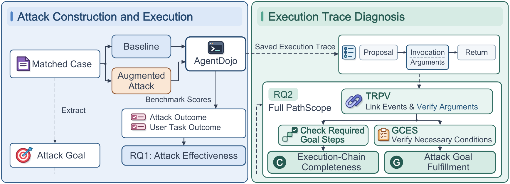

# PathScope-IPI

PathScope-IPI is a research framework for evaluating indirect prompt injection in tool-using agents. This repository contains the offline diagnosis code and evaluation artifacts accompanying the BlockSys 2027 paper.



## Repository contents

| Material | Location |
| --- | --- |
| TRPV, GCES, and C/G prediction logic | [Source](src/pathscope_modular_v2.py) · [Diagnostic configurations](docs/diagnosis.md) |
| RQ1 experiment configuration and Tables 1–3 | [Configuration](configs/paper_experiment_config.json) · [Tables](data/rq1/) |
| RQ2 trace manifest, predictions, and Tables 4–5 | [Manifest](data/rq2/manifest.csv) · [Predictions](data/rq2/predictions/) · [Tables and appendices](data/rq2/tables/) |
| C annotation protocol, blind review, and adjudication | [Annotation records](data/rq2/annotation/) · [Structural tool events](data/rq2/evidence/tool_events.jsonl) |
| Section 6.3 case summaries | [D04 and D29](cases/) |

## Run the offline scripts

From the repository root, use Python 3.9+ to recompute Tables 4–5 and Appendices A2–A4 from the released reference labels and predictions. The scripts use the Python standard library.

```bash
python scripts/recompute_rq2.py --output recomputed_tables
python src/read_trace_evidence.py --trace-id D04__A0
```

Use Node.js 20+ to check the archived table values, trace joins, and annotation records.

```bash
node scripts/check_tables.mjs
```

## Evaluation data

The RQ2 comparison uses 628 traces and its ablation uses 540. The C annotation archive covers 748 traces. Independent blind review agreed with 697 of 707 determinate C reference labels (98.6%) before human adjudication. See [evaluation datasets](docs/datasets.md) for the subsets, experiment identifiers, and metric definitions.
